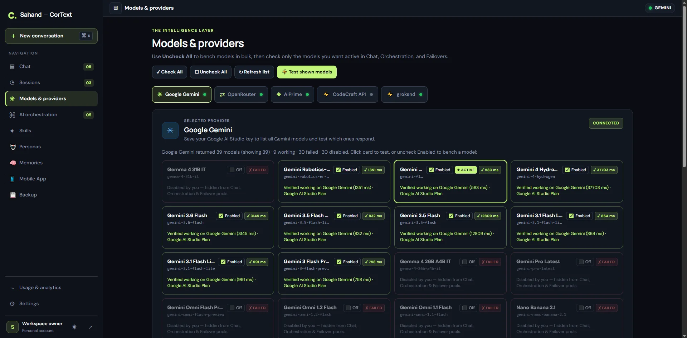
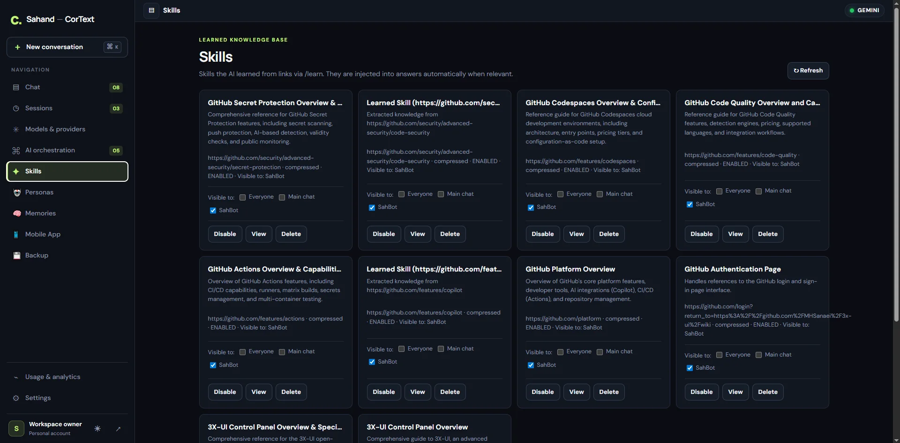

# Sahand-CorText · v0.9.8

**A private, secure, single-user AI workspace hosted on your own Ubuntu server.**

Sahand-CorText provides a private AI gateway where browser communication goes directly to your self-hosted server, while upstream AI provider requests are routed server-side to protect your client IP address.

It supports many providers through one registry — AIPrime, Google Gemini, Anthropic, OpenAI-compatible endpoints, and custom providers — plus multi-model orchestration, a skills engine that learns from web pages, Telegram bots, and personas.

---

## 📸 Screenshots

**Models & providers** — every provider's models in one registry, each tested live and enabled or benched with one click.



**Skills** — knowledge the AI learned from web pages via `/learn`, with per-skill visibility (everyone, main chat, or a persona).



**CorText Chat for Android** — the companion app ([sahand-cortext-android](https://github.com/sahand363/sahand-cortext-android)), streaming replies from your hub over an encrypted connection.

<p align="center"></p>

---

## 🚀 Quick Installation

### One-Line Installer

On a clean Ubuntu 22.04 or 24.04 server, run the following command with root privileges:

```bash
curl -fsSL https://raw.githubusercontent.com/sahand363/sahand-cortext/main/install.sh | sudo bash
```

The installer automatically:

- Checks and installs required prerequisites.
- Downloads the latest optimized pre-built release (linux/amd64; on ARM64 it builds locally).
- Creates a restricted system service account (`cortext`).
- Registers a sandboxed `systemd` service.
- Configures the application environment.
- Sets up your initial administrator credentials.

Once installation is complete, access your workspace using the displayed panel address.

---

## 🎛️ Server Administration

Sahand-CorText includes an interactive command-line management utility directly accessible from your server terminal.

Run:

```bash
sudo cortext
```

### Control Center Menu

| Option | Description |
|---|---|
| **1. Update Sahand-CorText** | Installs the latest binary and web files. The binary is checked against the release's `SHA256SUMS` before install, the previous version is kept for rollback, and if the new version doesn't start, the old one is restored automatically. |
| **2. Roll Back** | Restores the version you had before the last update (binary and web files). Also `sudo cortext rollback`. Your data, settings and chats are kept. Run it again to go forward. |
| **3. Show Panel Address** | Displays your local and remote panel URLs. |
| **4. Change Credentials** | Securely updates your administrator username and password. |
| **5. Configure / Renew SSL** | Installs Caddy, provisions Let's Encrypt certificates, and configures HTTPS and secure cookie flags. |
| **6. Restart Service** | Restarts the background application service. |
| **7. View Live Logs** | Streams real-time application logs using `journalctl`. |
| **8. Uninstall** | Removes application binaries, system services, and optionally database files. |

**Quick Update Command**

You can also update the application directly without opening the management menu:

```bash
sudo cortext update
```

---

## ✳️ AI Providers & Model Verification

Sahand-CorText connects to many providers through one registry. AIPrime (`https://api.aiprime.shop/v1`) is featured — `glm-5.3-flash` is the recommended model — and Google Gemini, Anthropic, OpenAI-compatible endpoints, and custom providers are supported too.

Follow these steps to connect a provider:

1. Open your browser and navigate to your server panel:

   ```text
   http://YOUR-SERVER-IP:8787
   ```

2. Log in using your administrator credentials.

3. Navigate to **Settings → AI Providers** and pick a provider.

4. Enter your **API key** for that provider and click **Save Key & Load Models**.

5. Sahand-CorText queries the provider's live model catalog and displays the models available to your API key.

6. Click any model card to perform a live generation test.

   Successfully tested models are highlighted in green, displaying their measured response latency:

   ```text
   ✓ WORKING · 180 ms
   ```

   The successfully tested model is automatically selected as your active chat model.

Models can be enabled or disabled individually (including a batch enable/disable for a whole provider), so you can keep only the 1–2 models you actually use active.

---

## 🛠️ Technology Stack

| Component | Technology |
|---|---|
| **Server OS** | Ubuntu Linux (AMD64 pre-built; ARM64 builds locally via the installer) |
| **Backend** | Go 1.23 (`net/http`, standard library concurrency) |
| **Database** | Embedded SQLite (`modernc.org/sqlite`, WAL mode, single connection) |
| **Authentication** | Bcrypt password hashing + persistent SQLite sessions, with login rate limiting |
| **Frontend** | Vanilla HTML5, CSS3, and JavaScript |
| **Deployment** | Pre-built static binary via GitHub Actions |
| **Service Management** | Sandboxed `systemd` service |
| **Reverse Proxy / SSL** | Caddy + Let's Encrypt (optional) |

---

## 📋 Core Capabilities

### 🔐 Private AI Gateway
All upstream AI provider requests originate from your Ubuntu server rather than your local browser, keeping your client IP address separate from provider-facing requests.

### 🤖 Multi-Provider Registry
AIPrime, Gemini, Anthropic, OpenAI-compatible, and custom providers behind one registry, with per-model enable/disable and live model discovery and testing.

### 🧑‍🤝‍🧑 AI Orchestration
Multi-model collaboration with intelligent task routing across specialized models, pause/resume, mid-job participant and model swapping, and a live progress timeline.

### 📚 Skills Engine
Learn a web page as a skill (`/learn`), or a page plus its same-site links (`/learn-deep`, up to 10 pages). Skills are managed on the **Skills** page and can be assigned to the main chat, to one or many Telegram bots, or to everyone. URL fetching blocks private, loopback, and internal addresses (SSRF protection).

### 💬 Telegram Bots
Long-polling Telegram bridge: each bot has its own persona, model, and skills. Commands: `/start`, `/help`, `/learn`, `/learn-deep`, `/skills`, `/new`, `/memory`, `/forget`, `/status`. Bot replies render mixed Persian/English correctly (RTL isolation).

**Private by design.** Telegram chats never appear in the panel or its API, not even to the owner. Each chat (bot + Telegram chat) is stored encrypted with AES-256-GCM under its own key, derived from a server secret (`$HUB_DATA_DIR/telegram-chats.key`, kept outside the database and outside backups) and the Telegram chat id. The database alone, or a backup, can't be read, and rows don't reveal which chat they belong to. Chats from older versions are encrypted and their plaintext deleted on first start.

**Remembers people.** Every few messages the bot extracts durable facts about the person it's talking to and keeps them, encrypted, in that chat's own memory, so it knows them next time. Each person can see what it remembers with `/memory` and erase it with `/forget`. `/new` starts a fresh conversation but keeps the memory.

Note: the hub has to decrypt a chat to reply, so someone with root on the server and the key file could still change the code to read chats. Moving the server or restoring a backup without the key file starts Telegram chats fresh.

### 📣 Telegram Channels
Write posts for your Telegram channel in a persona's voice. Give a subject and notes in the **Channels** tab and get a draft. Edit it, rewrite it with feedback, then post it from the hub, or send it to your Telegram DM and approve it there with **Post**, **Revise** or **Discard** buttons.
- **Setup:** create a separate bot with @BotFather (not a persona's bot), add it to the channel as an admin with *Post messages*, then paste its token and the channel link. Open the bot from the link the hub shows to pair your Telegram account for approvals. Only you can approve.
- **Style:** *Learn style* reads the channel's public posts (`t.me/s/<name>`) plus any samples you paste, and writes a style guide you can edit. Posts you publish, posts you write by hand in the channel, and your edits to drafts all feed back into later drafts.
- The bot token is stored encrypted, like API keys.

### 👤 Personas & Voice Trainer
Personas with their own system prompt, voice, and allowed models, usable in the web chat and in Telegram bots.

### 💬 Persistent Conversations
- SQLite-backed conversation storage.
- Persistent chat history across server restarts.
- Automatic conversation title generation based on the first prompt.

### 🛡️ Secure Session Management
- HTTP-only session cookies.
- Bcrypt password hashing.
- Persistent SQLite-backed sessions.
- Multi-day session persistence across server restarts.
- Failed-login delay plus per-IP rate limiting (temporary lockout after repeated failures).

### 👤 Single-User Architecture
Designed as a private personal AI workspace rather than a public, multi-tenant SaaS platform.

---

## 🗺️ Roadmap

The following modules are planned for future releases:

- [x] **Multi-Provider Registry:** Native integrations for AIPrime, OpenAI (GPT), Anthropic (Claude), DeepSeek, and custom OpenAI-compatible endpoints.
- [x] **AI Orchestration Layer:** Multi-agent coordination with intelligent task routing across specialized models.
- [ ] **Topic-Based Memory:** Cross-session vector or keyword-based memory retrieval for long-term project context.
- [ ] **Token & Cost Telemetry:** Usage analytics, token consumption tracking, and request latency history.

---

## 📂 Installation Directories

| Path | Description |
|---|---|
| `/opt/sahand-cortext/` | Application root directory and web assets (`web/dist/`). |
| `/var/lib/sahand-cortext/` | Persistent application data and SQLite database (`cortext.db`). |
| `/etc/sahand-cortext.env` | Environment configuration and security keys. |
| `/etc/systemd/system/sahand-cortext.service` | Background system service configuration. |
| `/usr/local/bin/cortext` | SSH-based management CLI utility. |

---

## 🔒 Security Recommendations

- **Enable HTTPS:** Always configure SSL using `sudo cortext` → Option 4 before exposing your panel to the public internet.
- **Protect Application Data:** Restrict access to `/var/lib/sahand-cortext/` and maintain regular database backups.
- **Use Strong Credentials:** Choose a strong administrator password and rotate it periodically through the SSH Control Center.
- **Keep Updated:** Regularly install the latest releases using `sudo cortext update`.
- **Protect API Keys:** Never share your provider API keys or expose them in frontend code.
- **Note:** Provider API keys are stored in the local SQLite database. Keep the database file private and back it up securely.

---

## 📄 License

See the [LICENSE](LICENSE) file for licensing information.

---

<p align="center">
  <b>Sahand-CorText</b><br>
  Private Intelligence. Your Server. Your Control.
</p>
