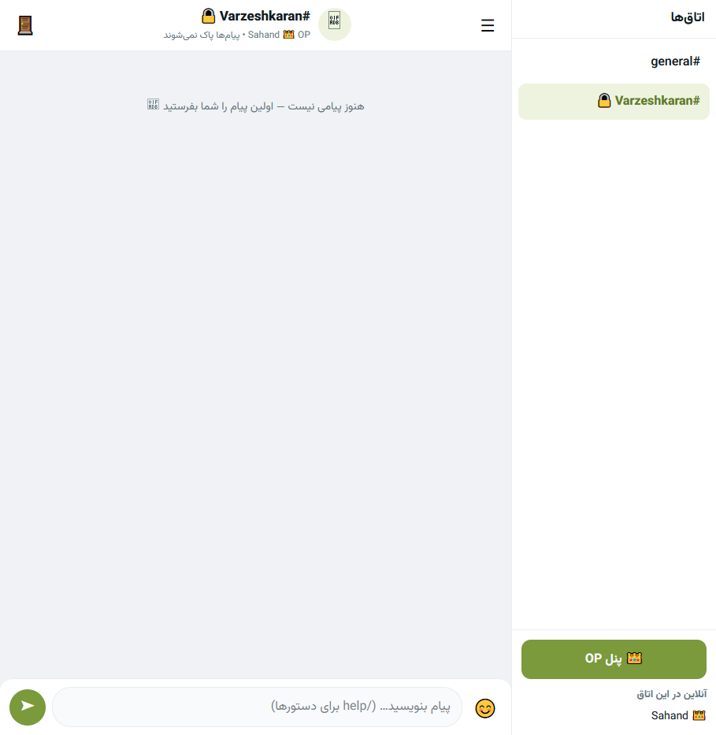

# 🫛 اتاق نخودی — Self-Hosted Chat

A complete, modern, self-hosted web chat in **Go (standard library only — no external dependencies)**, built for an Ubuntu server.

Mobile-first Persian RTL interface (Vazirmatn), real-time messages over SSE, persistent JSON storage, mIRC-style rooms, one OP in charge, and a clean CLI management menu. No database server, no compilation on the server — the binary comes pre-built from GitHub Actions.



> Screenshot: the chat running live — `#general` and a locked room `#Varzeshkaran`, with the 👑 OP panel and the online list. The room list is on the side (☰ on mobile).

---

## Quick install — one line

On a fresh Ubuntu server, as root (or with `sudo`):

```bash
curl -sSL https://raw.githubusercontent.com/sahand363/nokhodi-chat/main/install.sh | sudo bash
```

That's it. The installer:

1. Downloads the pre-built `linux/amd64` binary from the latest GitHub release
2. Installs it to `/opt/nokhodi-chat`, creates `config.json` + `data/`
3. Installs and starts the systemd service on port **44044**
4. Installs the `nokhodichat` command (`/usr/local/bin/nokhodichat`) to open the menu
5. Opens the management menu so you can set the OP and user passwords

Then open:

```
http://<server-ip>:44044
```

If the page doesn't load, open the port:

```bash
sudo ufw allow 44044/tcp
```

**Requirements:** Ubuntu (or any Linux with systemd), an open port 44044, and internet access for the one-time download. You do **not** need Go, Node, or a database on the server.

---

## How it works

### 1. Log in — two passwords, two roles

The login page asks for **one password only** — no username.

| Password | Who | What you get |
|---|---|---|
| **OP password** | Only you, the server owner | 👑 OP badge, the OP panel, and full control |
| **User password** | Everyone else | Just chat — join rooms and send messages |

The password you type decides your role. The server stores both passwords only as salted SHA-256 hashes, never in plain text.

**Defaults on a fresh install — change both at once:**

| Role | Default password |
|---|---|
| User (everyone) | `changeme123` |
| OP (only you) | `changeme-op123` |

Change them in the menu (`nokhodichat` → options **3** and **4**), in the 👑 OP panel inside the chat, or from the command line (see [Passwords](#passwords) below). If you are upgrading from v1, your old password stays as the user password, and the OP password starts as `changeme-op123` — change that first.

### 2. Pick your name + solve a captcha

After the password, each person picks their **own display name** and solves a simple maths captcha (addition / subtraction, e.g. `7 + 5 = ؟`).

- Display names must be unique while someone is online — two people can't impersonate each other.
- Your login stays remembered on that browser for **7 days** (session cookie, persisted in `data/sessions.json`). Your display name is remembered too.

### 3. Chat in rooms

The room list is on the side of the screen (tap ☰ on a phone to open it).

- **`#general`** is there by default. Your old v1 messages live there after an upgrade.
- Click a room to join it. Each room has its own history and its own live feed.
- Send messages, use the 😊 emoji picker, and use commands in the message box:

| Command | What it does |
|---|---|
| `/join #music` | Jump to a room by name |
| `/list` | Refresh the room list |
| `/me waves` | Sends `* YourName waves` |
| `/help` | Shows the commands |

- Click 🗑 on a message to delete it — your own messages, or **any** message if you're the OP.
- The header of each room tells you its self-destruct setting, e.g. "پیام‌ها بعد از ۲۴ ساعت پاک می‌شوند".
- The chat header shows the version (e.g. `v2.2.1`) next to the room name — that's the version the open tab is running. After a server update, **close the tab and open the chat again** (or hard-refresh with Ctrl+Shift+R): updating the server cannot reload a page that is already open, and the version badge is how you can tell at a glance whether the tab is on the new version.

### Sending images and files

Click the **📎** button right next to the ➤ send button (or write a caption first, then click 📎 — the caption is sent with the file).

- **Images** (JPG, PNG, WebP, **GIF** — animated GIFs play) are shown **big in the chat** (up to 320 px wide). Click an image to open it full-size in a new tab.
- **Other files** (PDF, TXT, MD, CSV, ZIP, MP3, MP4, Word / Excel / PowerPoint) show as a **download card** with the file name and size — click it to download.
- **Limits, per user:**
  - **50 MB** maximum per file
  - **5 files** per user per week
  - **150 MB** per user per day in total
  - **200 MB** stored per user at once — freed when a message expires or is deleted
- Executables and scripts (`.exe`, `.js`, `.html`, …) are rejected.
- Only people who have joined that room can download its files — hidden rooms' files stay hidden the same way. A file is deleted from disk when its message is deleted, expires, or its room is deleted.
- To change the limits, edit `config.json` (`max_upload_mb`, `max_uploads_per_user_per_week`, `max_upload_bytes_per_user_per_day`, `max_upload_bytes_per_user_total`) and restart the service. (Updating from v2.2.0/2.2.1 automatically moves your config to the new limits above.)

### Notification sound

When the chat tab is open but in the background (you're on another tab, or the window is minimized) and someone else sends a message, the tab plays a short two-tone beep — **but only once per 20 messages** while you're away, so a busy room doesn't beep non-stop. When you come back to the tab, the counter resets.

- The 🔊 button in the chat header turns the sound on/off (remembered in that browser).
- No sound file is needed — the beep is made by the browser itself (Web Audio).
- It only works while the tab is open in the background. If the tab is **fully closed**, nothing can beep — the page isn't running. (Real push notifications for a closed tab would need a service worker + server push, which this version doesn't have.)
- Browsers only allow sound after you've clicked or typed in the page once — so click in the chat once after opening it, and the beep will work from then on.

---

## Rooms — mIRC-style, with one OP

Only the OP can create, edit, or delete rooms. Regular users just join and chat. There are no per-room owners, no voting — it's your server.

### Creating a room (OP only)

In the chat, click **👑 پنل OP** (OP panel) → *ساخت اتاق جدید* (Create a room), and set:

| Setting | Meaning |
|---|---|
| **Name** | e.g. `music` → the room becomes `#music` |
| **Room password** | Optional. Empty = open room, anyone who is logged in can join. Set one = locked 🔒, joining asks for that room's password |
| **Hidden** | Tick this to hide the room from the list (see below) |
| **Self-destruct** | Never, 10 minutes, 1 hour, 24 hours, or 7 days |

The OP can also edit a room later (change its password, hide/unhide it, change its timer), or delete it. `#general` can't be deleted.

### Hidden rooms — secret link + room password

A hidden room is **not** in the room list for normal users.

- The OP copies its **secret link** from the OP panel. It looks like:
  ```
  http://<server-ip>:44044/?room=<id>&invite=<secret-token>
  ```
- Share that link privately. Opening it still asks for the **room password** — the link alone is not enough.
- Without the link *and* the password, the server returns **404** — no room name, no messages, no member list. Nothing leaks.
- The OP sees hidden rooms in the list with a 👁‍🗨 badge, and can copy the link again any time.

### Self-destructing messages

Each room has its own timer. The timer starts when a message is **sent**.

- The server deletes expired messages for everyone, every 30 seconds, and tells the room's open tabs to reload.
- Changing a room's timer only affects messages sent after the change — old messages keep their original expiry.

### Online users, kick / ban (OP only)

Under the room list you can see **who is online in the current room**.

- The OP can **ban a display name** from the online list or from the OP panel. That person is logged out immediately and can't pick that name again until the OP unbans them.
- The OP can delete any message from the 🗑 button on it.

---

## Management menu — `nokhodichat`

Type this in any SSH session to open the menu:

```bash
nokhodichat
```

(Or `sudo /opt/nokhodi-chat/manage.sh` if the shortcut isn't installed yet.)

The menu header shows the installed version, so you can see at a glance which version you're running:

```
🫛  اتاق نخودی — Management
  URL: http://<server-ip>:44044
  Dir: /opt/nokhodi-chat
  Version: nokhodi-chat 2.0.1

  1) Install / Start Service
  2) Update (latest release — keeps messages, rooms & config)
  3) Set User Password (everyone else)
  4) Set OP Password (only you — the admin)
  5) Status
  6) Uninstall
  7) SSL — Enable / Disable / Delete / Re-issue
  0) Exit
```

- **Update (option 2)** downloads the latest release and restarts the service. It keeps `config.json`, `data/rooms.json`, and every room's messages — nothing is wiped.
- **Status (option 5)** shows the version, the URL, and how many messages and rooms you have.
- **Uninstall (option 6)** stops the service and removes the program (and the `nokhodichat` shortcut). It asks whether to keep your messages and config.
- **Secret Front Door (option 8)** — hides the main chat behind a random link (see below). The menu header always shows the **Chat link** — the real link to the main chat, with the secret path in it when the front door is on — so you can never lock yourself out.

> **Menu tip:** if the menu ever prints "Invalid choice." without you typing anything, it was started from a pipe (for example, at the end of the `curl ... | bash` one-liner) instead of from your keyboard. That was fixed in v2.0.1 — the menu now reads from the real terminal and exits cleanly instead of looping. Just run `nokhodichat` from a normal SSH prompt.

---

## Private room links & secret front door — v2.3.0

Two ways to share a chat without showing the whole place.

**Private room link (focus mode).** In the 👑 OP panel, next to any room, **ساخت لینک خصوصی** makes a link like:

```
http://<server-ip>:44044/r/shdvbfsbd4r4t
```

Whoever clicks it goes **straight into that one room, full screen** — no room list, no other rooms, no OP panel, no online list, and `/join` and `/list` don't work there. The login password is still asked for first, and the room password too, if the room has one. (If the room has no password, the random link *is* the password — one click and they're in.) The OP can copy the link, make a **new** one (the old one stops working at once), or **delete** it. This replaces the old hidden-room invite link for one-to-one sharing — hidden rooms still exist for the room list, private links exist for a single guest.

**Secret front door.** Hides the main chat itself behind a random path:

```
http://<server-ip>:44044/shdvbfsbd4r4t
```

Visiting just `http://<server-ip>:44044/` then shows nothing (404). Turn it on in the menu (`nokhodichat` → **8) Secret Front Door**) or in the OP panel (**ورود مخفی به چت اصلی**), where you can also make a new link or turn it off again. The menu header always shows the current **Chat link**, so you can never lock yourself out of your own chat. This is obscurity, not security — it stops casual snoops and scanners, but the login password is still the real protection, so keep both.

**What about a different port per room?** Deliberately not built: a port number is easy to guess and scan, and every room would need its own firewall rule, service, and SSL certificate. The random path in the link is unguessable in a way a port number never is, and needs no extra setup.

## SSL / TLS — optional, from the menu

SSL is off by default — plain HTTP keeps working, and nobody is forced to use HTTPS. When you turn it on, the **same port (44044) serves HTTPS instead of HTTP**. Turn it off again and you're back on plain HTTP.

In the menu: `nokhodichat` → **7) SSL**, then:

| SSL menu | What it does |
|---|---|
| **1) Enable — Self-signed** | Makes a 365-day certificate on the server, no domain needed. Works with your server IP. Browsers will show a warning ("not secure / proceed anyway") because the certificate isn't signed by a public authority — that is normal for self-signed. Click Advanced → Proceed. |
| **2) Enable — Let's Encrypt** | Free, trusted certificate — no browser warning. Needs a **domain name that already points to this server** (DNS A record → your server IP) and port 80 reachable. The certificate renews itself automatically and the chat restarts on renewal. |
| **3) Disable SSL** | Back to plain HTTP. The certificate files are kept, so you can turn SSL back on without making a new certificate. |
| **4) Delete SSL certificate** | Deletes the certificate files and turns SSL off. For Let's Encrypt it also deletes the certificate from certbot. |
| **5) Delete & get a new certificate** | Deletes the old certificate, then asks whether the new one should be self-signed or Let's Encrypt. |

After enabling SSL, open the chat with **`https://`** instead of `http://`:

```
https://<server-ip>:44044          # self-signed, or with a domain:
https://<your-domain>:44044        # Let's Encrypt
```

**Without the menu** (same thing the menu does, on the server):

```bash
# Self-signed: make the certificate with openssl, then enable it
mkdir -p /opt/nokhodi-chat/tls
openssl req -x509 -newkey rsa:2048 -nodes \
  -keyout /opt/nokhodi-chat/tls/key.pem -out /opt/nokhodi-chat/tls/cert.pem \
  -days 365 -subj "/CN=<server-ip>" -addext "subjectAltName=IP:<server-ip>,IP:127.0.0.1"
/opt/nokhodi-chat/nokhodi-chat tls -enable true -mode selfsigned \
  -cert /opt/nokhodi-chat/tls/cert.pem -key /opt/nokhodi-chat/tls/key.pem
sudo systemctl restart nokhodi-chat

# Disable again (back to plain HTTP, certificate kept):
/opt/nokhodi-chat/nokhodi-chat tls -enable false
sudo systemctl restart nokhodi-chat

# Delete the TLS settings completely:
/opt/nokhodi-chat/nokhodi-chat tls -clear
sudo systemctl restart nokhodi-chat
```

**Notes:**
- SSL is a server-wide switch, not per user — when it's on, everyone uses `https://`, when it's off, everyone uses `http://`. There is no mixed mode on the same port.
- A self-signed certificate is still encrypted — the warning is only about *who* signed it, not about encryption.
- Let's Encrypt certificates last 90 days and renew automatically (certbot timer). If renewal ever fails, check that the domain still points to the server and port 80 is open, then use menu option 5 to re-issue.
- The certificate files live in `/opt/nokhodi-chat/tls/` (self-signed) or `/etc/letsencrypt/live/<domain>/` (Let's Encrypt). The `tls/` folder is not deleted by updates.

---

## Passwords

Change them in the menu (options 3 and 4), in the 👑 OP panel, or directly on the server — never share them in chat:

```bash
/opt/nokhodi-chat/nokhodi-chat passwd -role user -pass 'new-user-password'
/opt/nokhodi-chat/nokhodi-chat passwd -role op -pass 'new-op-password'
sudo systemctl restart nokhodi-chat
```

Passwords must be at least 6 characters. They are re-hashed with a fresh salt and written only as a hash to `config.json`.

---

## Update, uninstall, and check the version

**Update to the latest release (one line):**

```bash
curl -sSL https://raw.githubusercontent.com/sahand363/nokhodi-chat/main/install.sh | sudo bash
```

Or, in the menu: `nokhodichat` → **2) Update**.

**Check which version is running:**

```bash
/opt/nokhodi-chat/nokhodi-chat version
curl -s http://127.0.0.1:44044/health
```

A healthy server answers something like:

```json
{"messages": 12, "online": 2, "rooms": 3, "status": "ok", "title": "اتاق نخودی", "version": "2.0.1"}
```

**Uninstall completely (no menu needed):**

```bash
sudo systemctl stop nokhodi-chat; sudo systemctl disable nokhodi-chat
sudo rm -f /etc/systemd/system/nokhodi-chat.service /usr/local/bin/nokhodichat
sudo systemctl daemon-reload
sudo rm -rf /opt/nokhodi-chat
```

That removes everything, including messages and config. If you want to keep them, back up `/opt/nokhodi-chat/config.json` and `/opt/nokhodi-chat/data/` first, or use menu option 6 and answer "Y" to keeping them.

---

## What you get in this repo

| Piece | File |
|---|---|
| Go backend (OP/user auth, rooms, TTL, SSE, JSON store) | `main.go`, `server.go`, `auth.go`, `rooms.go`, `store.go`, `sse.go` |
| Frontend (login → name + captcha → rooms) | `web/index.html`, `web/style.css`, `web/app.js` |
| Management menu | `manage.sh` (`nokhodichat` in SSH) |
| One-line installer | `install.sh` |
| systemd service | `nokhodi-chat.service` |
| Screenshot used above | `docs/screenshot.png` |
| CI/CD (builds the binary on GitHub) | `.github/workflows/release.yml` |
| Config schema | `config.example.json` |

### Config — `config.json`

Created automatically on first run if missing. Passwords are hashes only:

```json
{
  "port": 44044,
  "host": "0.0.0.0",
  "user_password_hash": "<salted sha256, never plain text>",
  "user_salt": "<random hex>",
  "admin_password_hash": "<salted sha256, never plain text>",
  "admin_salt": "<random hex>",
  "session_days": 7,
  "data_dir": "data",
  "title": "اتاق نخودی",
  "tls_enabled": false,
  "tls_mode": "",
  "tls_domain": "",
  "tls_cert_file": "",
  "tls_key_file": ""
}
```

`tls_enabled: false` is the default (plain HTTP). When SSL is on, `tls_mode` is `"selfsigned"` or `"letsencrypt"`, and `tls_cert_file` / `tls_key_file` point at the certificate and key.

### Data — `data/`

| File | What it holds |
|---|---|
| `data/rooms.json` | The room list (name, hidden, TTL, room-password hash, invite token) |
| `data/room_<id>.json` | One file per room with that room's message history |
| `data/uploads/<roomID>/` | Uploaded image and file contents, one random-named file per upload |
| `data/sessions.json` | Logins (role + display name + unlocked rooms), 7 days |
| `data/bans.json` | Display names the OP has banned |

Update never deletes `config.json` or `data/`. Upgrading from v1 moves the old `data/messages.json` into `#general` automatically (the old file is kept as `messages.json.v1.bak`).

---

## API (for reference)

| Endpoint | Method | Who | Purpose |
|---|---|---|---|
| `/` | GET | — | Chat UI |
| `/health` | GET | — | `{"status":"ok", "version": "2.0.1", ...}` |
| `/api/captcha` | GET | — | New maths captcha `{id, question}` |
| `/api/login` | POST | — | Password only; returns `role` (`op` / `user`) |
| `/api/identity` | POST | Session | Display name + captcha answer |
| `/api/me` | GET | Session | `{authenticated, has_name, display_name, is_op}` |
| `/api/rooms` | GET | Session | Visible rooms only (hidden rooms are omitted) |
| `/api/rooms` | POST | OP | Create a room `{name, password, hidden, ttl_seconds}` |
| `/api/rooms/{id}` | GET | Session | Room info — hidden rooms return 404 without the link |
| `/api/rooms/{id}` | PATCH / DELETE | OP | Edit / delete a room |
| `/api/rooms/{id}/join` | POST | Session | Enter a room `{password, invite}` |
| `/api/rooms/{id}/messages` | GET / POST | Joined | Room history / send a message |
| `/api/rooms/{id}/messages/{mid}` | DELETE | Own message, or OP | Delete a message |
| `/api/rooms/{id}/upload` | POST | Joined | Upload a file (multipart, field `file`, optional `text` caption) — returns the message with its attachment |
| `/api/uploads/{roomID}/{fileID.ext}` | GET | Joined that room | Download / view a file — images are shown inline, other files download |
| `/api/rooms/{id}/events` | GET | Joined | SSE live feed for that room |
| `/api/rooms/{id}/online` | GET | Joined | Who is online in the room |
| `/api/admin/passwords` | POST | OP | Change the OP or user password |
| `/api/private/{code}` | GET | Session | Resolve a private room link to its room (404 for a dead link) |
| `/api/rooms/{id}/private-link` | GET / POST / DELETE | OP | Show / create-or-regenerate / delete a room's private link |
| `/api/admin/secret-path` | GET / POST | OP | Secret front door — `{action: enable, disable, regenerate}` |
| `/api/admin/ban` | POST | OP | Ban a display name (and log them out) |
| `/api/admin/bans` | GET | OP | List banned names |
| `/api/admin/unban` | POST | OP | Unban a display name |
| `/api/logout` | POST | Session | Log out |

---

## Publish a new version (for the owner)

The release workflow builds the binary on GitHub Actions whenever you push a version tag. Pushes to `main` alone don't create a release.

```bash
git add .
git commit -m "nokhodi chat v2.0.1 - ..."
git push origin main
git tag v2.0.1
git push origin v2.0.1
```

Then check **Actions** — the run should go green — and **Releases** should show `v2.0.1` with `nokhodi-chat-linux-amd64.tar.gz`. Only then will the one-line installer on the server download the new version.

> Don't commit `nokhodi-chat.zip` or `config.json` into the repo — the zip is only for sharing files, and `config.json` holds your password hashes. Both are in `.gitignore` for the binary and data, but check `git status` before you commit.

## Test locally (no server needed)

```bash
go vet ./...
go test ./... -v
go run . -config config.json
# then open http://localhost:44044
# user password: changeme123 — OP password: changeme-op123
```

---

## Troubleshooting

| Problem | Fix |
|---|---|
| Login says the password is wrong | In v2 the login is **password only** — there is no username box. Make sure you're typing the user password (for everyone) or the OP password (for you), not the old v1 `admin` login. If you forgot it, reset it on the server with the `passwd` commands in [Passwords](#passwords). |
| After enabling SSL, `http://` shows an error | That's expected — the same port now speaks HTTPS only. Use `https://<server-ip>:44044` instead. |
| After an update, the chat looks the same / a new button is missing | The tab was open before the update — the server can't reload it. Close the tab and open the chat again, or hard-refresh with Ctrl+Shift+R. The version badge in the header tells you which version the tab is running. |
| Browser warns about a self-signed certificate | Normal for self-signed. Click Advanced → Proceed (Chrome / Firefox). For no warning at all, use Let's Encrypt with a domain instead. |
| Let's Encrypt fails | Check the domain's DNS A record really points to the server IP, and port 80 is open (`sudo ufw allow 80/tcp`, and nothing else is using port 80). Then try menu option 5 to re-issue. |
| Menu prints "Invalid choice." with no typing, and flickers | The menu was started from a pipe, not from your keyboard. Fixed in v2.0.1 — update to v2.0.1, then run `nokhodichat` from a normal SSH prompt. |
| Menu won't take a number | Check your Windows keyboard is in **EN** mode — Persian digits (`۲`) don't count as `2`. |
| Page doesn't open | Check the service is running: `sudo systemctl status nokhodi-chat`, check the health URL above, and open the port: `sudo ufw allow 44044/tcp`. |
| Update didn't change the version | The new release wasn't published yet. Check GitHub → Releases for the new tag, and that Actions went green, then run the one-liner again. |
| A hidden room link says "room not found" | The link needs both the invite token *and* the room password. Check you copied the full link from the OP panel, and that you're entering the room's password — not the login password. |
| A banned name can't log in | That's the ban working. Unban it from the OP panel or with the `/api/admin/unban` endpoint. |

---

## Notes & limits

- **Plain HTTP on purpose:** the room is meant for a private server / LAN. If you expose it to the internet, put it behind TLS (Caddy / Nginx reverse proxy) and a firewall — and change both default passwords first.
- **Emoji:** full UTF-8 support, in messages and via the built-in emoji picker.
- **Storage:** JSON files, no database server to run. Fine for a small private room.
- **Real-time:** SSE (not WebSockets) — simpler, works through most proxies, auto-reconnects, and needs no external Go libraries.
- **Self-destruct timing:** the timer starts when a message is *sent*, and applies to new messages in that room. Changing a room's timer does not change messages already sent.
- **Hidden rooms are not secret by obscurity alone:** the link contains a random token, and the room password is still required. Without both, the server returns 404 and leaks nothing.

---

## Version history

- **v2.3.1** — Simpler OP panel: one button per room (copy the private link, or make one), the link shown short as `…/r/<code>`, and everything else (new link, delete link, hidden link, delete room) tucked behind a small "⋯ بیشتر". Nothing removed, just tidier.
- **v2.3.0** — Private room links (`/r/<random>` — focus mode, only that room, no sidebar/OP panel/online list, revoke or regenerate any time) and an optional secret front door for the main chat (`/<random>`, `/` returns 404 when on). The SSH menu header now shows the real **Chat link**, and menu option 8 manages the front door. No per-room ports — the random path is the unguessable part.
- **v2.2.2** — Upload limits changed (50 MB per file, 5 files per user per week, 150 MB per user per day, 200 MB stored — old configs are migrated automatically on restart), notification beep when the tab is in the background (once per 20 messages while away, 🔊/🔇 toggle in the header).
- **v2.2.1** — Version badge in the chat header (and login screen), no-cache headers so a reloaded tab always gets the new page, 📎 moved next to the send button with a visible background, SSH menu is plain ASCII only (no Persian characters — the old box-drawing header showed as boxes in some terminals).
- **v2.2.0** — Images and files in chat: 📎 upload button, images (incl. animated GIFs) shown big, other files as download cards, per-user limits (10 MB per file, 20 files / 100 MB per day, 200 MB stored), files deleted with their message.
- **v2.1.0** — SSL / TLS from the menu: self-signed or Let's Encrypt, disable, delete, and re-issue. Same port serves HTTPS when on, HTTP when off.
- **v2.0.1** — Menu fix: reads input from the real terminal (no more "Invalid choice." loop from a pipe), version shown in the menu header, uninstall also removes `nokhodichat`.
- **v2.0.0** — Rooms (mIRC-style), OP / user two-password login, per-room passwords, self-destruct timers, hidden rooms via secret link, online users, kick / ban, `/join` `/list` `/me` `/help`.
- **v1.0.2** — Renamed to اتاق نخودی, `nokhodichat` command added.
- **v1.0.0** — First release: single room, shared login, display name + maths captcha, SSE, JSON storage.
